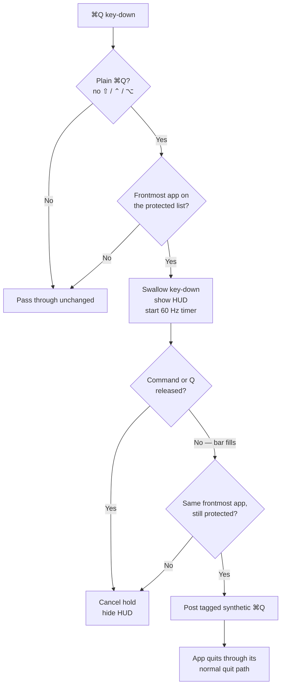

# CmdQGuard

<div align="center">
  
  <p>Figure 1: CmdQGuard Settings page</p>
</div>


**Hold ⌘Q to quit. Release early to cancel.**

CmdQGuard is a tiny macOS menu-bar app that turns quitting into a deliberate
action for the apps you choose. Press ⌘Q in a protected app and a warning HUD
appears; keep holding for **0.6 s** (adjustable) and the app quits normally.
Let go early and nothing happens.

It exists for the apps where a stray ⌘Q costs you work — Safari, editors,
terminals, notes.

| | |
|---|---|
| **Platform** | macOS 13+ (Apple silicon and Intel) |
| **Built with** | Swift 5, AppKit, SwiftUI |
| **Dependencies** | None beyond the macOS SDK |
| **Privacy** | No network access, no telemetry, no analytics |
| **License** | MIT |

## AI assistance

This is an **AI-assisted project**, and I'm disclosing that up front. I set the
requirements and UX, made the implementation decisions, and tested the app on
macOS. An AI coding assistant helped write and debug the Swift implementation
under my direction.

I'm responsible for the shipped behaviour, and the architecture notes below are
here so the code is easy to review. I'm happy to walk through any part of it —
especially the event-tap state machine and the permission handling, which are
the non-obvious parts.

## Why this exists

⌘Q sits next to ⌘W, and macOS treats it as an immediate quit. For most apps
that's fine; for the handful you keep open all day, one slip can discard
unsaved work. A modal confirmation on every quit interrupts the flow, and
guarding every app is overkill.

CmdQGuard takes a different approach: **protection is opt-in, and the decision
is a short physical hold rather than a click**. You keep the normal quit path
(including the app's own save prompts), you get a visible warning before
anything closes, and every unprotected app behaves exactly as before.

## Goals

I built this as a learning project with a practical constraint: I wanted a tool
I would actually keep running, not a demo.

- **Ship end to end.** Menu-bar lifecycle, settings UI, permission handling,
  login item, packaging, and documentation — the parts that separate a
  prototype from something installable.
- **Understand a system-level macOS feature.** Event taps, TCC, synthetic
  events, and code signing are usually hidden behind frameworks. I wanted to
  know how they behave, including when they fail.
- **Practice security-minded design.** Input monitoring is a sensitive
  capability. The app narrows it to one shortcut for an explicit whitelist,
  never records keystrokes, and contains no networking code.
- **Build something I can explain end to end.** Design decisions, tradeoffs,
  failure modes, and verification — not just a working binary.

## What it does

- **Hold ⌘Q in a protected app** → HUD appears, bar fills over the hold time,
  then a normal ⌘Q is sent and the app quits.
- **Release ⌘Q (or Command) early** → the HUD fades and nothing quits.
- **Unprotected apps** → a single ⌘Q quits immediately, no HUD.
- **Menu bar** → status, pause/resume, preview, settings, and direct links to
  the two Privacy & Security panes.
- **Settings** → master switch, hold time (0.3–3.0 s), protected-app list,
  launch at login.

Protection is a whitelist keyed by bundle identifier. **Safari is enabled on
first run**; everything else is opt-in. Keys are stored by bundle ID (falling
back to path), so a protected app stays protected across updates.

## How it works



### The event tap

`main.swift` installs a `CGEvent` tap at the **session level**, inserted at the
head of the event stream, and watches `keyDown`, `keyUp`, and `flagsChanged`.
The tap runs on the main run loop in common modes, so it keeps working while
menus or panels are open. If macOS disables the tap (timeout or user input),
the callback resets state and re-enables it.

The filter is deliberately narrow. An event is only considered when it is
keycode 12 (`Q`), carries Command, and carries none of Shift, Control, or
Option. Everything else is returned untouched. The frontmost app is resolved
with `NSWorkspace.shared.frontmostApplication` and checked against the
protected set before anything is swallowed.

### The hold state machine

`idle → holding → committing → quitting` is the core of the app:

- On a qualifying key-down: store the target PID, set `physicalQDown`, swallow
  the event, show the HUD, and start a 60 Hz timer. Key repeats for that
  physical press are swallowed too.
- Releasing Q or Command cancels the hold. `flagsChanged` covers the case where
  the user lets go of Command before Q.
- Progress is computed from `CACurrentMediaTime()` (monotonic) against the
  configured hold time. When the bar reaches 100%, the app waits ~0.12 s so the
  full bar renders, then commits.
- **Before quitting, it re-reads the frontmost app and compares the PID.** If
  focus moved or the app was switched off in Settings during the hold, the quit
  is abandoned. It never quits a different app than the one named in the HUD.
- The quit itself is a **synthetic ⌘Q posted at the HID event tap**, tagged via
  `eventSourceUserData` so the tap recognises it and lets it through instead of
  catching it again. The app's normal quit path runs — no `terminate()`, no
  `kill()`. A short watchdog resets state if the app does not actually quit.

### The HUD

A borderless `NSPanel` styled as a non-activating floating panel: screen-saver
level, joins all Spaces, auxiliary in full-screen, mouse-transparent, and it
never steals focus. It centres on the screen under the pointer and fades in and
out; a generation counter prevents a stale fade-out from hiding a newer HUD.
The bar is drawn in a custom `NSView`, driven by the 60 Hz timer.

### Settings and permissions

- `AppSettings` is a singleton `ObservableObject` backed by `UserDefaults`
  (`enabled`, `launchAtLogin`, `holdDuration`, `enabledAppKeys`,
  `customAppPaths`).
- The app list combines running regular apps, a scan of `/Applications`,
  `/System/Applications`, and `~/Applications`, plus apps added manually with
  an `NSOpenPanel`. It skips itself.
- Launch at login uses `SMAppService.mainApp`; the settings window surfaces
  `requiresApproval`, `notFound`, and registration failures instead of hiding
  them.
- The app runs as an **accessory** (no Dock icon) and refuses to start a second
  instance outside demo mode.

### Permissions are the real constraint

Intercepting and modifying keys needs two separate TCC grants:

1. **Accessibility** — required to swallow events and post the synthetic quit.
2. **Input Monitoring** — required to observe key events at all.

The app checks `AXIsProcessTrusted()` and `CGPreflightListenEventAccess()`,
prompts once for each, then polls every 1.25 s until both are granted and the
tap can be installed. The menu bar icon shows a warning triangle until the tap
is live, and the menu links directly to both settings panes. Losing a permission
does not crash or wedge the app; it falls back to passing events through.

### Privacy

There is no networking code in the project — no `URLSession`, no sockets, no
analytics SDK. Settings live in local `UserDefaults`; app icons and bundle
metadata are read locally. The only console output is in the demo and CLI modes.

## Design decisions and tradeoffs

- **Whitelist, not blacklist.** Protection is opt-in because a tool that
  changes ⌘Q everywhere is surprising and hard to trust. Safari is the single
  default so the app does something useful on first launch.
- **Swallow and re-post, instead of calling `terminate()`.** Re-posting ⌘Q lets
  each app run its own quit path, including save sheets and unsaved-document
  prompts. The cost is that the app has to tag and filter its own synthetic
  event to avoid a loop.
- **Re-check the target PID at commit time.** Focus can change during a hold.
  Quitting whatever happens to be frontmost when the timer fires would be a
  serious bug, so the app verifies identity and protection immediately before
  posting the quit.
- **Session event tap, not per-app automation.** Apple Events or menu
  interception would be narrower, but would not reliably catch every app's own
  ⌘Q handling. The tradeoff is broad input access and the TCC prompts that come
  with it.
- **Ad-hoc signing.** The app builds locally with no developer account. The
  downside is that each rebuild changes its code identity, so macOS may require
  re-granting permissions.
- **No Force Quit protection.** CmdQGuard covers the ⌘Q shortcut, not
  `⌥⌘Esc`, `kill`, crashes, or shutdown.

## Build and run

Requires macOS 13+ and the Xcode Command Line Tools (`xcode-select --install`).

```sh
./build.sh
open build/CmdQGuard.app
```

For a stable permission grant, move `CmdQGuard.app` somewhere permanent — for
example `/Applications` — before launching it for the first time. Rebuilding
the app changes its ad-hoc signature, so macOS may ask for permissions again.

The app has no Dock icon. Look for the **⌘ icon in the menu bar**.

## Grant permissions

1. **Accessibility** — allows CmdQGuard to swallow ⌘Q and send the real quit
   shortcut after the hold.
2. **Input Monitoring** — allows CmdQGuard to see the key events at all.

On first launch the app asks for Accessibility first. Enable **CmdQGuard** in:

- System Settings → Privacy & Security → **Accessibility**
- System Settings → Privacy & Security → **Input Monitoring**

If CmdQGuard is not listed in a pane, click **+** and choose the app. After
Accessibility is enabled, the app asks for Input Monitoring. If macOS does not
notice a grant immediately, quit CmdQGuard from its menu and reopen it. The menu
also has direct links to each pane.

## Usage

- **Hold ⌘Q in a protected app** → the app receives a normal ⌘Q after the
  configured hold time and quits.
- **Unprotected apps** → a single ⌘Q quits immediately.
- **Release early** → the HUD fades and nothing quits.
- **Menu bar ⌘ icon**:
  - *Settings…* — general options and per-app protection.
  - *Warn Before Quitting* — pause/resume.
  - *Launch at Login* — quick login-item toggle.
  - *Show Preview* — preview the HUD without holding keys.
  - *Accessibility Settings…* / *Input Monitoring Settings…*.
  - *Quit CmdQGuard*.

The HUD is non-activating, so it appears over the current app (including
full-screen apps) without stealing focus.

## Preview without granting permissions

```sh
open -W build/CmdQGuard.app --args --demo
```

Shows the hold-to-quit HUD for a few seconds and exits without quitting
anything.

```sh
open -W build/CmdQGuard.app --args --settings-demo
```

Shows the Settings window for a few seconds and exits.

## Verification

- Clean checkout + `./build.sh` builds `build/CmdQGuard.app`; the ad-hoc
  signature verifies with `codesign --verify --deep --strict`.
- `--demo` and `--settings-demo` run without Accessibility or Input Monitoring
  grants.

## What I learned

- **Event taps are a pipeline, not a callback.** The tap sees key events before
  the focused app. Returning `nil` swallows an event; returning it passes it
  through. Tap placement, event ordering, and re-enabling after a timeout all
  change the behaviour.
- **TCC is two independent gates.** Accessibility allows modifying events;
  Input Monitoring allows observing them. "One granted, one missing" is a real
  state the app has to handle, not an edge case.
- **Input handling is a state machine.** Key repeats, Command release, focus
  changes, and a commit delay all interact. Explicit phases made the behaviour
  predictable and reviewable.
- **Synthetic input needs provenance.** Re-posting ⌘Q would be caught by my own
  tap. Tagging the synthetic event and filtering on the tag breaks the loop
  without weakening the filter.
- **Verify identity at the last moment.** Focus can change during a hold, so
  the app re-checks the frontmost PID immediately before quitting. Never act on
  stale UI state.
- **Permissions are product design.** Explaining why each grant is needed,
  linking to the exact settings pane, and degrading safely matters as much as
  the code that uses the permission.
- **App identity is part of the build.** Ad-hoc signing changes identity on
  every rebuild, which resets TCC grants. That has to be documented, not
  discovered by users.

Taken together, this was practice in the kind of work I want to do in IT:
configuring per-app policy, handling sensitive OS permissions, debugging across
process boundaries, and documenting a reproducible setup.

## Next steps

- Extract the hold logic into a testable core and add unit tests for the state
  machine (modifier release, repeats, focus changes, commit timing).
- Sign with a Developer ID and notarize so permission grants survive updates.
- Add per-app hold times, and detect Secure Input to show a paused state instead
  of silently passing ⌘Q through.

## Project structure

```
main.swift          app lifecycle, event tap, hold state machine, HUD, menu bar
SettingsView.swift   settings store, app scanning, SwiftUI settings UI, login item
Resources/Info.plist app bundle metadata (LSUIElement, bundle ID, version)
build.sh             compile + bundle + ad-hoc codesign
```

## Limitations

- **Secure Input** blocks event taps. While a password field (or a terminal with
  "Secure Keyboard Entry") is focused, ⌘Q may pass through unguarded.
- This does not prevent **Force Quit** (`⌥⌘Esc`), `kill`, crashes, or shutdown.
- Only the plain ⌘Q shortcut is guarded. App-specific quit buttons and
  ⇧⌘Q-style shortcuts are not intercepted.
- The app is ad-hoc signed. Rebuilding changes its identity, so macOS may
  require removing and re-adding the Accessibility/Input Monitoring grants.
- CmdQGuard must be running. Launch at login keeps it active.

## License

MIT — see [LICENSE](LICENSE).

---

Built by [Gregory Handoyo](https://github.com/greghandoyo).
